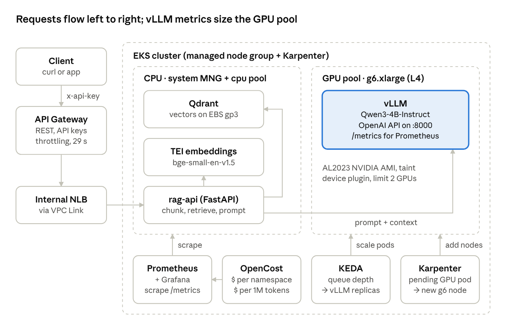

# EKS LLM Lab

Self-hosted LLM platform on Kubernetes (EKS).

## Overview
- An EKS cluster serving an open model through vLLM on a single NVIDIA L4 GPU.
- A small RAG API behind Amazon API Gateway.
- Dashboards showing latency, cost per million tokens, and node pool scaling.

All infrastructure is defined as Terraform, split into four small stacks applied in order.

## Architecture


Requests enter through API Gateway (API key, throttling, 29 s timeout), cross a VPC Link to an internal NLB, and
reach `rag-api`, which embeds with TEI, retrieves from Qdrant and sends prompt plus context to vLLM on the GPU
pool. Prometheus scrapes vLLM's `/metrics`; KEDA scales vLLM replicas on queue depth, and Karpenter adds a `g6`
node when a GPU pod is pending.

The diagram shows the target design. The TEI model is set by `tei_model` in `02-apps/terraform.tfvars`
(currently `BAAI/bge-base-en-v1.5`), and OpenCost is not installed yet (see [Known Gaps](#known-gaps)).

## Repository Layout
```
llm-lab/
├── modules/
│   └── k8s-manifests/  # applies a folder of YAML (*.yaml, *.yaml.tftpl) via kubernetes_manifest
├── 00-infra/      # VPC, EKS, node group, IAM, Karpenter IAM, ECR (aws provider only)
├── 01-platform/   # Helm charts: Karpenter, LB controller, device plugin, Prometheus, KEDA, Qdrant
├── 02-apps/       # manifests/{karpenter,llm,rag}: NodePools, vLLM, TEI, KEDA, alerts, rag-api
├── 03-gateway/    # API Gateway REST API, VPC Link, usage plan
├── docs/          # architecture diagram
└── rag-api/       # FastAPI source + Dockerfile
```

Each stack is split by concern (`versions.tf`, `providers.tf`, `variables.tf`, `outputs.tf`, one file per
component) and reads the stacks before it through `terraform_remote_state`. State is local
(`<stack>/terraform.tfstate`), so run every stack from the same checkout.

## Prerequisites
- Service Quotas increased for Running On-Demand G and VT instances (≥8 vCPUs).
- Terraform 1.9+, AWS CLI v2, kubectl, helm, Docker with buildx, Python 3.12, jq.
- Optional: Hugging Face token (model used is ungated).

## Configuration
Every tunable value lives in the stack's `terraform.tfvars` (loaded automatically); `variables.tf` only declares
types, descriptions and validation, with no defaults.

| Stack | Main settings in `terraform.tfvars` |
|---|---|
| `00-infra` | `name`, `region`, `tags`, VPC CIDRs (the number of `private_subnets` sets the AZ count), `kubernetes_version`, `system_node_group`, `endpoint_public_access` |
| `01-platform` | `chart_versions` for all Helm charts |
| `02-apps` | `images`, `vllm` (model and server args), `vllm_autoscaling`, `tei_model`, `gpu_node_pool` / `cpu_node_pool`, `node_class`, `nlb_name` |
| `03-gateway` | `api_name`, `stage_name`, `integration_timeout_ms`, `usage_plan` (throttle and daily quota) |

Keep `gpu_node_pool.cpu_limit` within your G/VT vCPU quota, and `vllm_autoscaling.max_replicas` within what that
limit fits (one GPU node per replica; two `g6.xlarge` with the default 8 vCPUs). Spot and On-Demand have separate
quotas ("All G and VT Spot Instance Requests" vs "Running On-Demand G and VT instances"), and new accounts often
start with a Spot quota of 0; check it in Service Quotas before applying a spot-only `capacity_types`.

The system node group runs one node, and Karpenter runs one replica on it (its chart requires one replica per
non-Karpenter node). Change the group's size with `min_size`/`max_size`: the EKS module ignores later
`desired_size` changes.

Manifests in `02-apps/manifests/` are rendered with `templatefile()`: `.yaml.tftpl` files take values from the
module calls in `02-apps/*.tf`. A literal `${` or `%{` in any manifest must be written `$${` / `%%{`. See
[modules/k8s-manifests/README.md](modules/k8s-manifests/README.md) for how manifests are rendered and applied.

## Deploy
Apply the stacks in order; each one needs the previous stacks' state.

```bash
# 1. VPC, EKS, IAM, ECR
terraform -chdir=00-infra init && terraform -chdir=00-infra apply

# 2. Build and push rag-api (02-apps deploys <ecr_repository_url>:<rag_api_image_tag>)
ECR=$(terraform -chdir=00-infra output -raw ecr_repository_url)
REGION=$(terraform -chdir=00-infra output -raw region)
aws ecr get-login-password --region "$REGION" | docker login --username AWS --password-stdin "${ECR%%/*}"
docker buildx build --platform linux/amd64 -t "$ECR:latest" --push rag-api

# 3. Helm charts (Karpenter, LB controller, NVIDIA plugin, Prometheus, KEDA, Qdrant)
terraform -chdir=01-platform init && terraform -chdir=01-platform apply

# 4. Karpenter NodePools, vLLM, TEI, rag-api and its internal NLB
terraform -chdir=02-apps init && terraform -chdir=02-apps apply

# 5. API Gateway in front of the NLB
terraform -chdir=03-gateway init && terraform -chdir=03-gateway apply
```

kubectl access:
```bash
aws eks update-kubeconfig --name "$(terraform -chdir=00-infra output -raw cluster_name)" --region "$REGION"
```

vLLM's first start downloads the model weights and can take up to ~15 minutes (`kubectl -n llm get pods -w`).

## Use the API
Every request needs the API key from the usage plan.

```bash
URL=$(terraform -chdir=03-gateway output -raw invoke_url)
KEY=$(terraform -chdir=03-gateway output -raw api_key)
curl -H "x-api-key: $KEY" "$URL/health"

# Ingest: each document is split into 800-char chunks; re-ingesting a source replaces its chunks
curl -sL https://raw.githubusercontent.com/vllm-project/vllm/main/README.md -o vllm.md
jq -n --rawfile t vllm.md '[{source: "vllm-readme", text: $t}]' |
  curl -s "$URL/ingest" -H "x-api-key: $KEY" -H 'Content-Type: application/json' -d @-

# Ask: answers only from the top_k (default 4, max 20) closest chunks; sources[n-1] is citation [n]
curl -s "$URL/ask" -H "x-api-key: $KEY" -H 'Content-Type: application/json' \
  -d '{"question": "Which hardware does vLLM support?"}' | jq
```

`/ask` returns 404 until something is ingested, 503 while vLLM is paused or starting, and 502 if TEI is down.

## Pause the GPU overnight
vLLM never scales below `vllm_autoscaling.min_replicas` (1) on its own. To stop paying for the GPU node, pause
KEDA at zero replicas; Karpenter then removes the empty node:

```bash
kubectl -n llm annotate scaledobject vllm autoscaling.keda.sh/paused-replicas="0" --overwrite   # pause
kubectl -n llm annotate scaledobject vllm autoscaling.keda.sh/paused-replicas-                  # resume
```

## Cost Estimate
- The GPU node is the largest cost; pause it when idle (see above).
- Spot g6.xlarge ~$0.35/h in us-east-1 (may be interrupted).

## Tear Down
Destroy in reverse order:

```bash
terraform -chdir=03-gateway destroy    # VPC Link first: it targets the NLB owned by 02-apps
terraform -chdir=02-apps destroy       # deletes NodePools; Karpenter then terminates its nodes
kubectl get nodeclaims                 # wait until empty, or Karpenter's EC2 instances are orphaned
terraform -chdir=01-platform destroy
terraform -chdir=00-infra destroy
```

## Known Gaps
- The gateway proxies every path, so any API key holder can also call `/ingest` and read `/metrics`.
- The cost-per-million-tokens recording rule in `llm-rules.yaml` reads `node_total_hourly_cost`, which comes from
  OpenCost; OpenCost is not installed yet, so that metric and dashboard stay empty.
