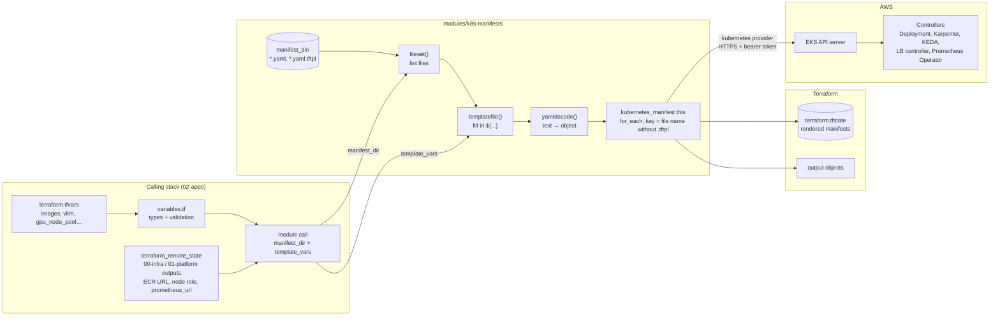
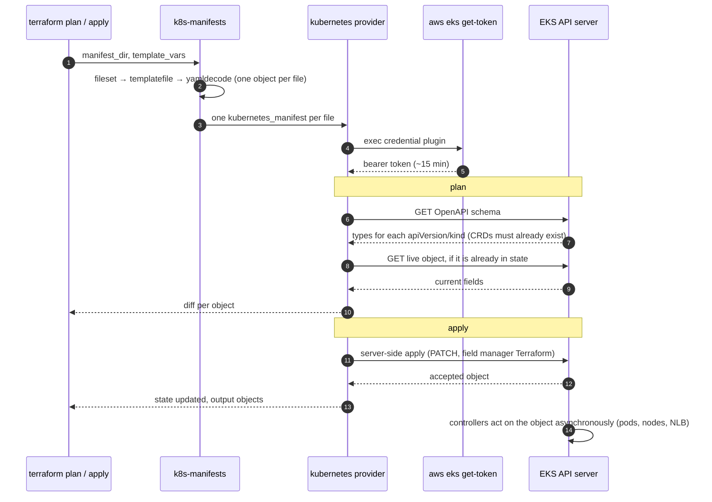

# k8s-manifests

Applies every Kubernetes manifest in one folder through `kubernetes_manifest`. Each file can contain `${...}`
placeholders, which are filled in from Terraform values before the object is sent to the cluster. Manifests
stay plain YAML: there is no HCL translation and no typed `kubernetes_*` resources.

Used by `02-apps`:

| Call | Folder | Objects |
|---|---|---|
| `module.karpenter_nodes` | `02-apps/manifests/karpenter` | EC2NodeClass, GPU and CPU NodePools |
| `module.llm` | `02-apps/manifests/llm` | vLLM, TEI, ScaledObject, ServiceMonitor, PrometheusRule |
| `module.rag` | `02-apps/manifests/rag` | rag-api Deployment and internal NLB Service |

## Usage

```hcl
module "llm" {
  source = "../modules/k8s-manifests"

  manifest_dir = "${path.module}/manifests/llm"
  template_vars = {
    vllm_image     = var.images.vllm               # from terraform.tfvars
    vllm           = var.vllm                      # objects work: ${vllm.model}
    prometheus_url = local.platform.prometheus_url # from another stack's state
  }

  depends_on = [module.karpenter_nodes] # optional ordering between folders
}
```

The module has no `provider` block. It uses the calling stack's `kubernetes` provider, which is also why
`depends_on` is allowed on the module call.

## Inputs

| Name | Type | Description |
|---|---|---|
| `manifest_dir` | `string` | Folder to read. Only files directly in it are used, not subfolders. |
| `template_vars` | `any` | Values available as `${name}` in every file of the folder. Default `{}`. |

## Outputs

| Name | Description |
|---|---|
| `objects` | Map of file key to `Kind/namespace/name`, e.g. `"vllm-deployment.yaml" = "Deployment/llm/vllm"`. |

## How data moves

Values start in the calling stack, are written into the YAML text, parsed into objects, and sent to the EKS API
server. Nothing is written to disk in between; the rendered manifest exists only in Terraform's plan and state.



`templatefile()` runs on every file, `.yaml` and `.yaml.tftpl` alike, so a plain `.yaml` file comes out
unchanged. The `.tftpl` suffix only marks files that use placeholders.

## Request flow

What the provider sends to the cluster during `plan` and `apply`. Authentication goes through the calling
stack's `exec` block, which runs `aws eks get-token` for a short-lived token.



Two consequences of this flow:
- **The cluster must be reachable at `plan` time**, and every custom resource type a file uses (NodePool,
  ScaledObject, ServiceMonitor, …) must already be installed. The stack order provides this: `00-infra`
  creates the cluster and `01-platform` installs the CRDs before `02-apps` runs.
- **`apply` does not wait for workloads.** It returns once the API server accepts each object. Pods starting,
  Karpenter launching nodes and the LB controller creating the NLB all happen after Terraform finishes.

## File rules

- **One object per file.** `yamldecode` reads a single YAML document, so `---` between objects fails.
- **Escape literal template markers.** Write `$${` and `%%{` for a literal `${` or `%{`. PromQL and most YAML
  never contain them.
- **Every placeholder must be in `template_vars`.** A missing value fails `plan` with an error instead of
  applying a broken manifest.
- **`template_vars` is shared by the whole folder.** Two files can't use `${image}` for different images; give
  each its own name (`vllm_image`, `tei_image`).
- **The file name is the resource key.** Renaming `foo.yaml` to `bar.yaml` deletes `foo` and creates `bar`.
  Adding or removing `.tftpl` keeps the same key.
- **Lists and maps go in as JSON**, which YAML accepts: `values: ${jsonencode(gpu.capacity_types)}`.

## Common tasks

| Task | What to do |
|---|---|
| Add an object | Drop a new `.yaml` file in the folder; the next `plan` shows it. |
| Remove an object | Delete the file; `apply` deletes it from the cluster. |
| Make a field configurable | Replace it with `${name}`, rename the file to `.yaml.tftpl`, add `name` to the module call's `template_vars`, and declare and set the value in the stack's `variables.tf` and `terraform.tfvars`. |
| See what is applied | `terraform -chdir=02-apps output objects` |
